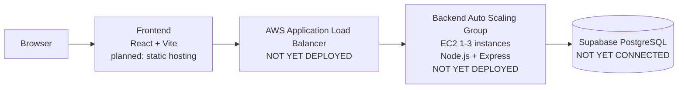
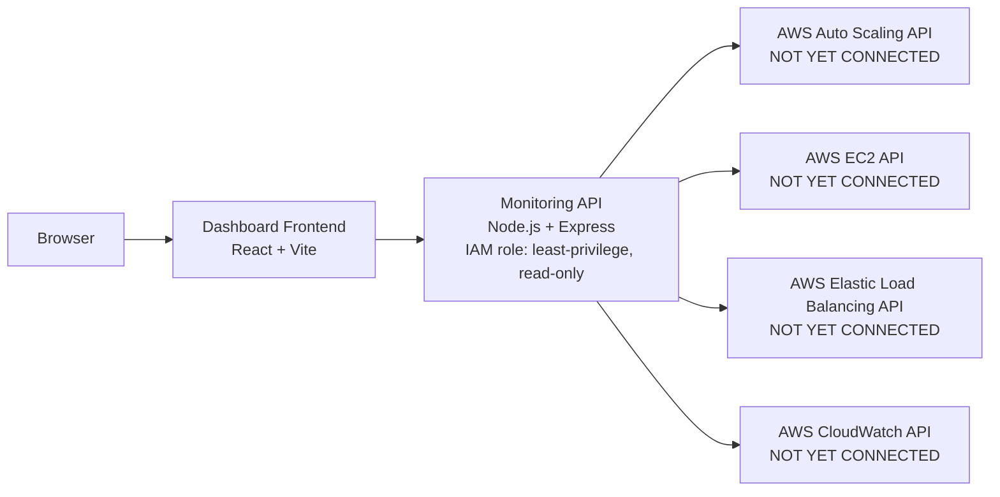

# Architecture (Initial / Conceptual)

> **Status:** Planned architecture only. None of the AWS infrastructure
> described below has been provisioned yet. This document will be updated as
> each piece is actually built and deployed.

## High-level flow

## Monitoring dashboard flow

The monitoring dashboard is a separate application with its own API. It does
not share a codebase or deployment with the storefront backend.

## Components implemented so far (this initial setup stage)

| Component | Status |
|---|---|
| `frontend/` | Placeholder React page only, no API calls wired up |
| `backend/` | Express server with `GET /api/health` only |
| `dashboard/frontend/` | Placeholder React page only |
| `dashboard/monitoring-api/` | Express server with `GET /api/health` only, no AWS calls |
| `database/` | Empty migrations/seeds folders, no Supabase connection |
| AWS resources (ALB, ASG, EC2, IAM, CloudWatch) | Not created |
| Terraform (`infrastructure/terraform/`) | Not written |
| Load tests (`load-tests/`) | Not written |

## Planned later stages

1. Implement the products API and connect the backend to Supabase.
2. Build the full storefront UI in `frontend/`.
3. Write Terraform (or scripted AWS CLI) to provision VPC, EC2 launch
   template, Target Group, Application Load Balancer, and an Auto Scaling
   Group (min 1, max 3 instances) with a CPU-based scaling policy.
4. Create a least-privilege IAM role (read-only `Describe*`/`List*`
   permissions for EC2, Auto Scaling, ELB, and CloudWatch) and attach it to
   the monitoring API's EC2 instance.
5. Implement the monitoring API's real AWS calls and wire them into the
   dashboard frontend.
6. Write k6 load-test scenarios and run them against the ALB DNS name at
   1, 2, and 3 backend instances to produce the performance report.

See `docs/09-aws-learner-lab-playbook.md` for relevant AWS Academy Learner
Lab constraints researched earlier in the project.
